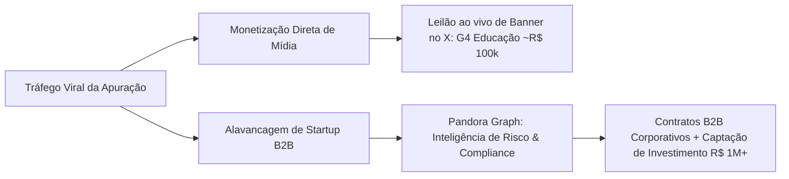
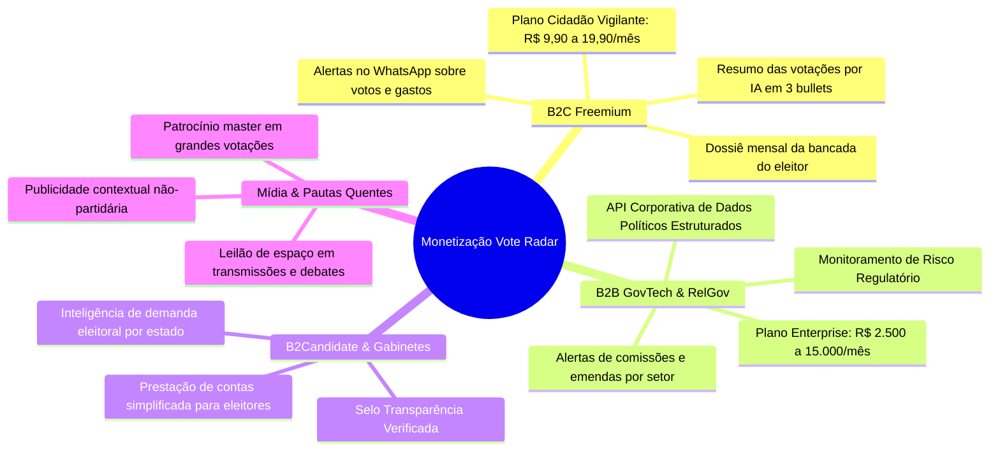

# 📊 Plano de Negócios e Estratégia de Monetização: Vote Radar

> **Documento Estratégico de Produto e Negócios**  
> **Baseado no estudo de caso:** `seuimposto.com` (Bruno César / Pandora Graph)  
> **Aplicação direta:** Plataforma **Vote Radar** (`politica-tracker`)

---

## 📌 Sumário Executivo

O mercado de tecnologia cívica (*GovTech* e *CivicTech*) e inteligência regulatória no Brasil vive um ponto de inflexão. Historicamente, projetos de dados abertos eram restritos a ONGs e iniciativas voluntárias sem modelo de monetização claro.

Recentemente, o case do **`seuimposto.com`** demonstrou que existe uma demanda reprimida gigantesca da sociedade civil, da mídia e de corporações por **interfaces de dados públicos que sejam rápidas, transparentes e visuais**.

Enquanto plataformas de apuração sofrem com a **sazonalidade eleitoral bienal** (picos de 1 dia a cada 2 anos e deserto de audiência nos outros dias), o **Vote Radar** possui uma vantagem competitiva estrutural: **o mandato dura 4 anos**, com votações, emendas e gastos acontecendo semanalmente.

Este documento detalha a engenharia reversa do caso `seuimposto.com`, desenha as **4 avenidas de receita do Vote Radar** e traça o plano de execução para atingir **R$ 1 milhão+** em faturamento e captação.

---

## 🔍 1. Estudo de Caso e Engenharia Reversa: `seuimposto.com`

### 1.1. O que aconteceu na prática?
Durante as eleições, os portais do TSE e grandes veículos de imprensa sofriam de gargalos históricos: interfaces lentas, poluição visual e dados agregados de forma pouco intuitiva.

O desenvolvedor **Bruno César** ([@brunoclz](https://x.com/brunoclz)), ex-engenheiro de dados do BTG Pactual, consumiu os arquivos JSON da CDN de divulgação de resultados do TSE e lançou uma interface em Next.js/React de alta performance com mapas vetoriais interativos e projeção município a município.

### 1.2. O Ciclo de Viralização
* **Produto 10x melhor que o concorrente:** Atualizava em frações de segundo, sem travamentos.
* **Adoção por criadores de conteúdo e podcasts:** O mapa virou a tela padrão de transmissões ao vivo com milhões de espectadores (podcasts políticos, canais do YouTube e streamers).
* **Métricas alcançadas:** Pico superior a **140 mil conexões simultâneas** e mais de **1 milhão de usuários únicos** no domingo da eleição.

### 1.3. Como foi gerado mais de R$ 1 milhão?
A monetização ocorreu em dois estágios:



1. **Monetização de Oportunidade (Leilão ao Vivo):** No ápice da audiência, Bruno abriu um leilão de lances públicos no X (Twitter) pelo espaço publicitário do topo do site. O **G4 Educação** arrematou o banner por valores da ordem de dezenas/centenas de milhares de reais (fechando cerca de **R$ 100 mil** em um único dia).
2. **Autoridade e Validação Corporativa (A Grande Alavancagem):** O site serviu como demonstração ao vivo da capacidade da sua empresa, a **Pandora Graph** (startup focada em análise de risco, grafos de relacionamentos de dados públicos e detecção de fraudes). A notoriedade atraiu clientes do mercado financeiro, escritórios de advocacia e investidores, alavancando contratos e captações que ultrapassam a casa de **R$ 1 milhão**.

### 1.4. Lições e Limitações do Modelo
| Força do `seuimposto.com` | Fragilidade | Oportunidade para o Vote Radar |
| :--- | :--- | :--- |
| Explosão viral em poucas horas | Sazonalidade extrema (queda de 99% do tráfego pós-eleição) | O Vote Radar fiscaliza os **365 dias do ano** de mandato |
| Excelente experiência do usuário | Ausência de retenção e login de usuários | O Vote Radar possui sistema de contas, favoritos e notificações |
| Monetização instantânea por leilão | Dependência de um único patrocinador esporádico | Receita recorrente (ARR) via B2C (assinaturas) e B2B (SaaS) |

---

## 🎯 2. Posicionamento do Vote Radar: A Vantagem Competitiva

O **Vote Radar** não é uma ferramenta de apuração de 24 horas; é uma **plataforma contínua de inteligência e transparência política**.

### Ativos Já Construídos na Plataforma:
1. **513 Deputados Federais + 81 Senadores + Governantes** catalogados e rastreados.
2. **Despesas da CEAP (Cota Parlamentar)** discriminadas nota a nota com CNPJ, fornecedor e data.
3. **Votações Nominais e Presença** sincronizadas diretamente das APIs oficiais da Câmara e do Senado.
4. **Calculadora de Compatibilidade Ideológica/Temática**: Confronto entre as opiniões do cidadão e o voto real dos políticos.
5. **Rastreabilidade e Neutralidade Editorial**: Separação inequívoca entre *Dado Oficial*, *Análise do Sistema* e *Opinião do Usuário*.

---

## 💰 3. Os 4 Pilares de Monetização do Vote Radar



---

### Pilar 1: B2C Freemium — O "Cidadão Vigilante"
O modelo B2C atua como mecanismo de distribuição em massa, aquisição de leads e receita estável por volume.

* **Nível Gratuito (Free):**
  * Consulta ilimitada ao perfil dos parlamentares.
  * Visualização de gastos e histórico público de votações.
  * Teste básico de afinidade eleitoral.
* **Nível Premium ("Cidadão Vigilante" — R$ 9,90 a R$ 19,90 / mês):**
  * **Alertas no WhatsApp / Telegram:** Notificação push imediata quando o deputado que você segue vota em plenário ou gasta na CEAP fora do padrão histórico.
  * **"Explica essa Votação" (Inteligência Artificial):** Tradução de pareceres técnicos e projetos de lei herméticos em 3 pontos objetivos: *"O que muda"*, *"Quem ganha"* e *"Quem perde"*.
  * **Relatório Mensal de Mandato em PDF:** Dossiê para compartilhar em grupos com o desempenho dos parlamentares do seu estado.

---

### Pilar 2: B2B GovTech & RelGov (Relações Governamentais)
Este é o canal de **maior ticket médio e maior LTV (Lifetime Value)**. Empresas e associações investem fortunas em consultorias para saber com antecedência o andamento de pautas que afetam seus negócios.

* **Público-alvo:**
  * Associações de classe (FIESP, Febraban, Abrasel, sindicatos patronais).
  * Escritórios de advocacia especializados em Direito Público e Tributário.
  * Empresas de setores altamente regulados (Fintechs, Saúde/Farma, Apostas/iGaming, Energia, Agro).
* **Solução Oferecida:**
  * **Painel de Risco Regulatório:** Monitoramento de palavras-chave em Projetos de Lei e Emendas em tramitação nas comissões temáticas.
  * **Matriz de Alinhamento da Bancada:** Identificação preditiva de deputados favoráveis e contrários com base no histórico de votação partidária.
  * **API de Dados Vote Radar:** Feed de dados estruturados em JSON para integração em sistemas internos de compliance e auditoria.
* **Faixa de Preço:**
  * **Pro:** R$ 1.900,00 / mês (até 3 usuários, 5 alertas setoriais).
  * **Corporate:** R$ 4.900,00 a R$ 12.000,00 / mês (usuários ilimitados, API dedicada, suporte especializado).

---

### Pilar 3: B2Candidate & Gestão de Gabinete (Pré-Campanhas)
Nos períodos de pré-campanha e anos eleitorais, mandatários e desafiantes buscam ferramentas confiáveis para balizar discursos e demonstrar transparência.

* **Selo "Mandato Aberto / Transparência Verificada":** O parlamentar assina uma conta institucional que permite publicar notas oficiais justificando formalmente cada voto polêmico diretamente na sua página do Vote Radar.
* **Inteligência de Sentimento e Demandas Regionais:** Relatórios analíticos anônimos com dados consolidados dos eleitores: *"Quais temas os cidadãos de Minas Gerais mais priorizaram no teste de afinidade nos últimos 90 dias?"*.
* **Preço:** R$ 1.500,00 a R$ 5.000,00 por gabinete / mês de contrato de monitoramento de imagem pública de dados.

---

### Pilar 4: Mídia de Oportunidade & Leilão de Pautas Quentes (O Playbook Bruno César)
Em dias de votações cruciais no Congresso Nacional (Reforma Tributária, Orçamento da União, CPIs, julgamentos políticos ou eleições):

* **Painéis Especiais ao Vivo:** Uma página de "Votação em Tempo Real" do Vote Radar com gráficos atualizados voto a voto.
* **Leilão de Patrocínio Master:** Venda antecipada ou leilão de espaço em banner de topo para patrocinadores não-partidários:
  * Plataformas de educação executiva (G4, Conquer, etc.).
  * Plataformas financeiras e de investimentos (XP, BTG, corretoras).
  * Softwares de contabilidade e gestão (Omie, Contabilizei, Totvs).
  * Portais de jornalismo independente e newsletters.
* **Valor Potencial por Evento:** R$ 20.000 a R$ 100.000 por cobertura exclusiva de grande votação.

---

## 🛠️ 4. Arquitetura Técnica Necessária no Repositório

Para suportar essas linhas de receita no monorepo atual (`apps/web` e `apps/api`), o roadmap técnico envolve 4 componentes:

### 4.1. Módulo de Alertas em Tempo Real (WhatsApp / Email)
* **Local:** `apps/api/src/notifications/`
* **Tecnologias:** Integração via Z-API / Evolution API (WhatsApp) e Resend (Email transacional).
* **Função:** Disparar mensagem sempre que um parlamentar com `favorite: true` tiver uma despesa lançada na CEAP acima do desvio padrão ou registrar voto em plenário.

### 4.2. Camada de Síntese por Inteligência Artificial
* **Local:** `apps/api/src/ai/`
* **Tecnologias:** LLM (Gemini 1.5 Flash / Claude Haiku) para geração de resumos em linguagem acessível e neutra.
* **Função:** Transformar ementas legislativas em resumos estruturados com badges de impacto econômico e social.

### 4.3. Gateway de Pagamentos e Assinaturas
* **Local:** `apps/api/src/billing/` e `apps/web/app/planos/`
* **Tecnologias:** Stripe ou Asaas (com suporte nativo a **PIX Recorrente / Cobrança Automática**).
* **Modelos no Prisma:** Entidades `Subscription`, `Plan`, `Customer` e `WebhookLog`.

### 4.4. API Gateway B2B com API Keys
* **Local:** `apps/api/src/api-keys/`
* **Tecnologias:** Rate limiting por Token (Throttler), autenticação via header `x-api-key`.
* **Função:** Permitir que clientes corporativos consultem os dados normalizados via REST.

---

## 📈 5. Projeção Financeira: Rumo ao R$ 1.000.000,00

### 5.1. Cenário de Faturamento Recorrente Anual (ARR)

| Linha de Receita | Volume de Clientes | Ticket Médio Mensal | Receita Mensal (MRR) | Receita Anual (ARR) |
| :--- | :--- | :--- | :--- | :--- |
| **B2C: Assinaturas Cidadão Vigilante** | 2.500 assinantes | R$ 14,90 | R$ 37.250,00 | R$ 447.000,00 |
| **B2B: RelGov & Monitoramento Corporativo** | 12 empresas/associações | R$ 3.500,00 | R$ 42.000,00 | R$ 504.000,00 |
| **B2Candidate: Gabinetes & Pré-Campanhas** | 8 mandatos | R$ 2.000,00 | R$ 16.000,00 | R$ 192.000,00 |
| **Mídia de Oportunidade: Votações & Eleições** | 4 eventos no ano | R$ 40.000,00 (por evento) | — | R$ 160.000,00 |
| **TOTAL CONSOLIDADO** | — | — | **R$ 95.250,00/mês** | **R$ 1.303.000,00/ano** |

---

## 🚀 6. Cronograma de Execução em 4 Fases

```text
[Mês 1 - 2] FASE 1: Tração Orgânica & Captura de Leads
├── Implementação de captura de leads no cadastro ("Receba alertas no WhatsApp")
├── Criação dos scripts de "Dados Chocantes" para redes sociais (rankings de gastos)
└── Publicação do primeiro release público da plataforma

[Mês 3 - 4] FASE 2: Lançamento do B2C Freemium
├── Integração de pagamento via PIX Recorrente (Asaas / Stripe)
├── Ativação do robô de notificações de votação e CEAP
└── Lançamento dos resumos de projetos de lei gerados por IA

[Mês 5 - 7] FASE 3: Validação da Oferta B2B GovTech
├── Criação da landing page corporativa (`/empresas` ou `/inteligencia`)
├── Montagem do deck de vendas para escritórios de advocacia e associações
└── Fechamento dos primeiros 3 clientes piloto a R$ 2.500/mês

[Mês 8 - 12] FASE 4: Alavancagem em Pautas Quentes e Escala
├── Cobertura de grandes votações nominais com página em tempo real
├── Execução do playbook de patrocínio master e leilão de mídia
└── Abertura de rodada de investimento ou consolidação de caixa próprio
```

---

## 🏆 Conclusão e Diretriz

O caso do **`seuimposto.com`** provou que transparência pública gera engajamento estrondoso no Brasil. A chave para transformar esse interesse em um negócio milionário e duradouro no **Vote Radar** é combinar **a visibilidade viral do B2C com a alta monetização do B2B corporativo**.

O código e a estrutura do **Vote Radar** já possuem a base técnica necessária. O próximo passo é ativar os canais de captura e os gatilhos de monetização documentados neste plano.
